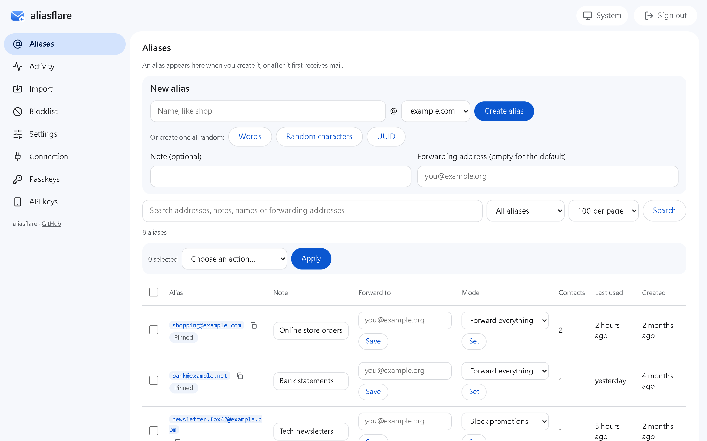
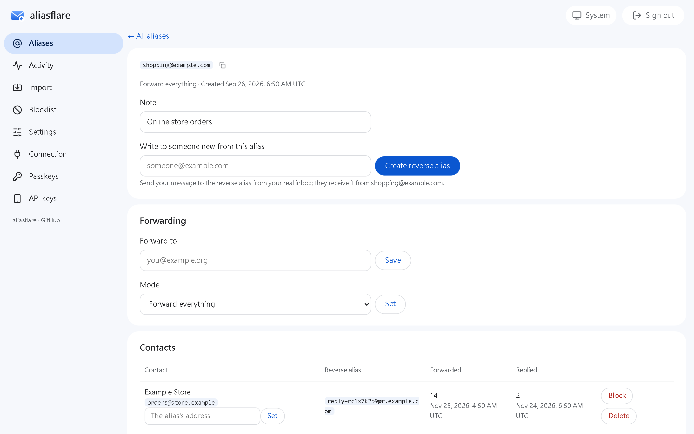
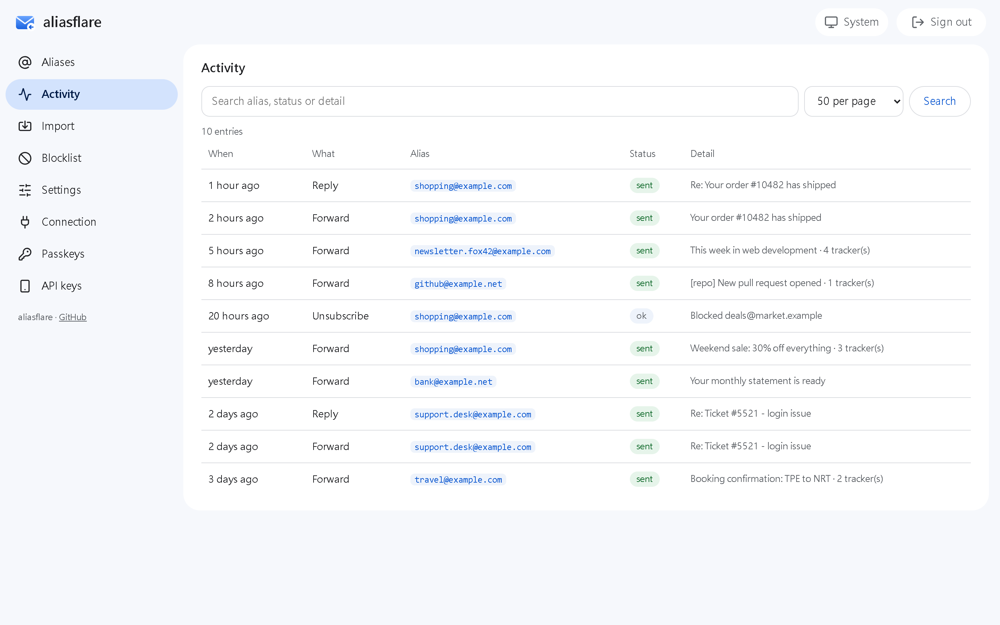
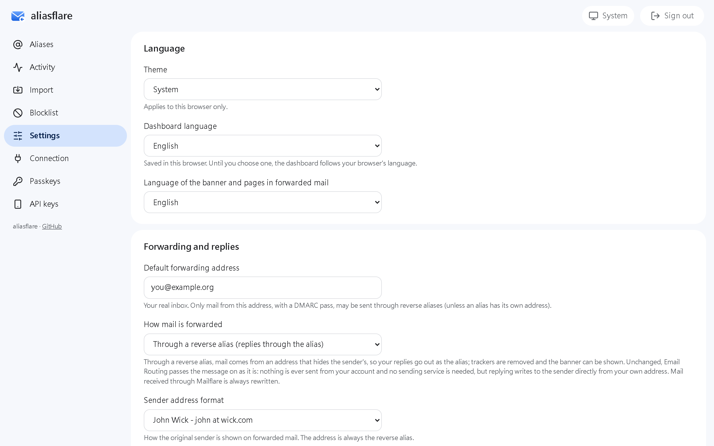
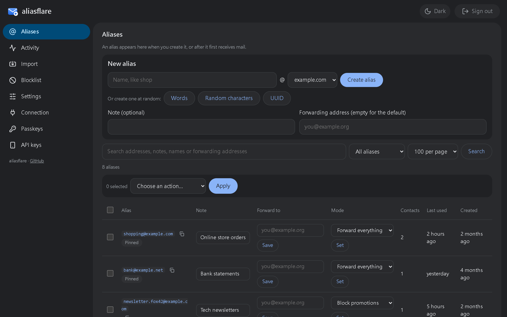
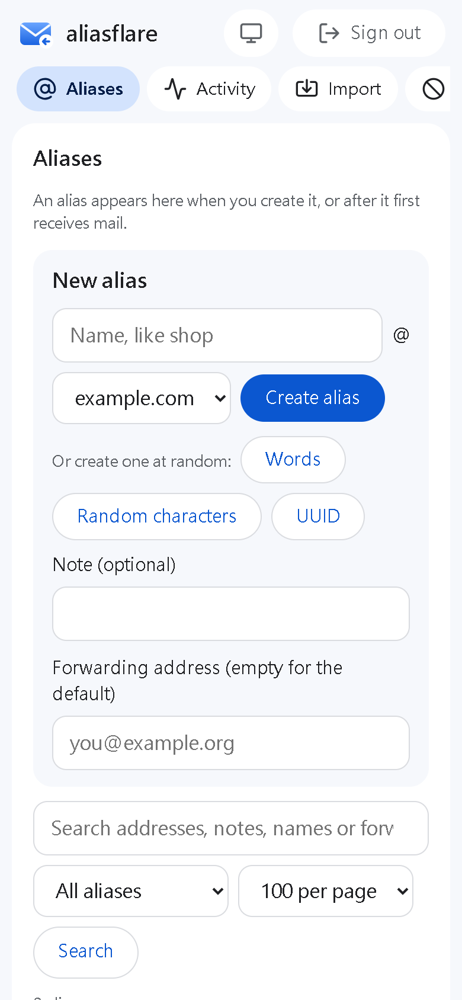

# aliasflare

SimpleLogin-style **email aliases with reverse aliases**, on one Cloudflare Worker with Cloudflare Email Routing and Email Sending.

Give every site its own address on your domains. aliasflare forwards their mail to the inbox you already use, like Gmail. When you reply there, the reply goes out from the alias, so the other side never sees your real address.

[繁體中文說明](README.zh-TW.md)

## Screenshots



| An alias and its contacts | Activity |
| --- | --- |
|  |  |
|  |  |

<p align="center"></p>

## Features

**Aliases and replies**
- **Any number of alias domains.** Mail to any address on them arrives (an Email Routing catch-all), and you can create aliases ahead of time on the alias page or from the apps.
- **Forward to your real inbox.** Every alias forwards to a default address, or to its own.
- **Reply through reverse aliases.** Each correspondent gets a private address. Mail you send to it goes out from the alias.
- **One reverse-alias domain per alias domain.** Correspondents of `shop@a.com` write to `reply+…@r.a.com`, those of `me@b.net` to `reply+…@r.b.net`. Nothing a correspondent sees ties your domains together, and a reverse alias only works on its own domain.
- **Write to someone new.** Create a reverse alias for any address and start the conversation from your real inbox.
- **Threading.** Message-IDs are mapped both ways, so conversations stay threaded on both sides.

**SimpleLogin-style settings**
- **Sender address format.** How the original sender appears on forwarded mail: `John Wick - john at wick.com`, `John Wick - john(a)wick.com`, `John Wick`, `john at wick.com`, or no name.
- **Reverse alias replacement.** In your replies, reverse aliases in the body become the real address, and your real address becomes the alias.
- **Include sender address in reverse alias.** New reverse aliases can read `john_at_wick_com_x7k2p9@…` instead of a random string.
- **One-click unsubscribe** (RFC 8058). Your mail client's Unsubscribe button disables the alias, blocks that sender, sends that sender's mail to another address (a mailbox for newsletters, say), or runs the sender's own unsubscribe on your behalf, with a fallback of your choice when that fails. Each alias domain can have its own setting, and any contact can be given its own forwarding address on the alias page.

**Privacy and control** (ideas from addy.io, Firefox Relay, DuckDuckGo Email Protection and SimpleLogin)
- **Tracker removal.** Drops tracking pixels and strips tracking parameters (`utm_*`, `fbclid`, `mc_eid`, …) from links.
- **Forwarding banner** with the alias, the sender, how many trackers were removed, one-click **Block sender** and **Disable alias**, and a warning (also in the subject) when the sender failed DMARC.
- **Forwarding modes per alias.** *Forward everything*, *Block promotions* (list mail) or *Forward nothing*.
- **Blocklist** of addresses, or domains with their subdomains, across all aliases.
- **Search and batch editing** of the alias list, and **notes** edited in place.

**Apps and browser extensions**
- **SimpleLogin and addy.io clients.** Turn on either API in Settings, create an API key, and point the official SimpleLogin or addy.io app or browser extension at your Worker. Bitwarden's alias generator works too.
- **MCP server** for AI assistants: list, create and switch aliases and edit their notes. It never sees mail, senders or activity.
- **Import from SimpleLogin or addy.io**, with their API key or alias export (CSV), including SimpleLogin contacts.

**Dashboard**
- **Passkey sign-in**, with no password.
- **Cloudflare set up from the dashboard.** With an API token, one button sets up every alias domain: catch-all, reverse-alias domain, routing rule and Email Sending.
- **35 languages**, right to left where needed, in light and dark mode, on phones and desktops.

**Optional: Mailflare.** If you run [Mailflare](https://github.com/hieunc229/mailflare), it can receive some domains instead and keep a copy of every message; aliasflare then forwards from its webhook and sends replies through Mailflare, so they appear in its Sent folder.

## How it works

```
                        ┌───────────────── aliasflare Worker ─────────────────┐
 sender ──▶ shop@a.com ─┤ Email Routing catch-all of a.com                     │
                        │ removes trackers, adds the banner                    │
                        │ sends it from reply+x7k2…@r.a.com (Email Sending)    ├──▶ you@gmail.com
                        └──────────────────────────────────────────────────────┘
 you@gmail.com ──reply to reply+x7k2…@r.a.com (Email Routing rule reply@r.a.com)
                        │ checks: sender is you, and Cloudflare's DMARC verdict is pass
                        ▼
                 Email Sending ──from shop@a.com──▶ sender
```

## Requirements

- A Cloudflare account. The **Workers Free** plan works: forwards to your own mailbox use Cloudflare Email Sending, which delivers to verified destination addresses on any plan. Mail to other people (replies through reverse aliases, senders' mailto unsubscribe) needs either **Workers Paid** for Email Sending or another sending service (Resend, SMTP2GO, Brevo, Postmark, Mailgun, Amazon SES, any SMTP server or a custom HTTP request), with each alias domain verified there. Most have a free plan. If you only want to receive, none is needed: choose receive-only forwarding (step 8).
- One or more **alias domains** on Cloudflare. Each one must be a **zone apex** (`a.com`, not `mail.a.com`), because Email Routing has catch-all rules only on the apex, and it should receive no other mail: Email Routing takes over its MX records.

## Setup

### 1. Deploy

```bash
git clone https://github.com/TWME-TW/aliasflare.git
cd aliasflare
npm install
npx wrangler d1 create aliasflare      # copy the database_id into wrangler.jsonc (or a git-ignored wrangler.local.jsonc)
npx wrangler d1 migrations apply DB --remote
npx wrangler deploy
```

### 2. Register your passkey

1. Open `https://aliasflare.<you>.workers.dev/`. You land on the setup page.
2. Get the **one-time setup code**: run `npx wrangler tail aliasflare` and press *Write a new code to the logs* on the setup page; the code appears in the terminal. (It is also in the Worker's logs in the Cloudflare dashboard, under the Worker's *Observability* tab.) To use your own code instead, set a `SETUP_CODE` secret.
3. Enter the code and register a passkey.

### 3. Settings

- **Forwarding address**: your real inbox.
- **Alias domains**: `a.com, b.net`. Each gets the reverse-alias domain `r.a.com`, `r.b.net`.

### 4. Cloudflare

**Automatically.** On **Connection**, tick the domains, paste an API token and click **Set up automatically**. Create the token under *My Profile → API Tokens* with these permissions for the zones:
- Zone → Zone → Read
- Zone → Zone Settings → Edit
- Zone → DNS → Edit
- Zone → Email Routing Rules → Edit
- **Account** → Email Sending → Edit

The first four are **zone** permissions: under *Zone Resources*, choose *Include → Specific zone* and add each alias domain's zone, so the token can change no other domain. Email Sending is an **account** permission: under *Account Resources*, include your account.

For each domain this enables Email Routing and points the catch-all at the Worker, enables Email Routing on `r.<domain>` with subaddressing and a rule for `reply@r.<domain>`, and onboards both for Email Sending. A catch-all that already sends mail somewhere else is left unchanged. Running it again is safe. The token is used once and not stored.

**By hand**, for each alias domain `a.com`:
1. Email Routing on `a.com`: enable it; set the catch-all to *Send to a Worker* → `aliasflare`.
2. Email Routing on `r.a.com`: enable it, turn on **subaddressing**, and add the custom address `reply@r.a.com` with *Send to a Worker* → `aliasflare`.
3. Email Sending: onboard `r.a.com` and `a.com`.

A subdomain allows at most 200 routing rules, which is why one rule for `reply@` with subaddressing covers every reverse alias.

### 5. Optional: SimpleLogin and addy.io apps

1. In **Settings → Apps and browser extensions**, turn on *Support SimpleLogin clients*, *Support addy.io clients*, or both.
2. On **API keys**, create one key per app or extension.
3. In the app or extension, choose the self-hosted option and enter the URL shown on the API keys page and the key (SimpleLogin: *API URL*; addy.io: *Instance URL*).

**Bitwarden** (and Vaultwarden, which uses the same apps) can create an alias for each new login with its *Forwarded email alias* generator. It is available in the browser extension and the desktop app.

1. Turn on SimpleLogin or addy.io support and create an API key for Bitwarden, as above.
2. In Bitwarden, open **Generator → Username**, choose **Forwarded email alias**, then a service:
   - **SimpleLogin**: *API key* is the key; *Self-host server URL* is your Worker's URL, for example `https://alias.example.com`. The alias prefix comes from the site's name.
   - **Addy.io**: *API access token* is the key; *Domain name* is one of your alias domains; *Self-host server URL* is your Worker's URL. The site's name is saved as the alias's note.
3. Enter the URL **without** `/api` and with `https://`: Bitwarden adds the API path itself.

If a WAF is in front of the Worker, keep `/api/` free of challenges (see step 9).

### 6. Optional: import from SimpleLogin or addy.io

On **Import**, list the domains to bring over, then paste a SimpleLogin or addy.io API key or upload their alias export (CSV). Aliases on SimpleLogin's or addy.io's own domains keep receiving mail there, so leave those out; for your own domains, move them to Cloudflare and add them as alias domains.

### 7. Optional: Mailflare

On **Connection → Mailflare**, enter the Mailflare URL, a **personal** API key (*Settings → API keys*, with `send` and `jmap`, for every mailbox to forward) and the signing secret of a `message.inbound` webhook to the URL shown there (*Admin → Webhooks*, as the primary admin). Domains Mailflare receives need no catch-all in Email Routing, but their reverse-alias domain does need step 4's routing rule. If Mailflare runs on the same account, the `MAILFLARE_SERVICE` service binding keeps requests inside Cloudflare.

### 8. Workers plan and sending provider

On **Connection → Sending mail**, choose your Workers plan (Free is assumed) and what sends replies, with its key:

| Service | What it needs |
| --- | --- |
| Cloudflare Email Sending | Workers Paid to send to other people |
| Resend, SMTP2GO, Brevo, Postmark | an API key |
| Mailgun | an API key and the region (US or EU); each alias domain is a Mailgun sending domain |
| Amazon SES | an IAM access key ID and secret allowed `ses:SendRawEmail`, and the region |
| SMTP server | host, port (587 STARTTLS or 465 TLS; port 25 is closed to Workers), user name and password: works with almost any provider or your own server |
| Custom HTTP request | an https URL, header lines and a JSON body with placeholders such as `{{to}}`, `{{subject}}`, `{{html}}`, `{{attachments}}` or `{{raw}}` (the whole message in base64); the key is `{{api_key}}` |

How much you can send is set by your plan with that service, not by aliasflare.

**Receive only.** If you never want to reply through aliases, set **Settings → How mail is forwarded** to *Unchanged (receive only)*. Email Routing then passes each message on as it is: nothing is sent from your account and no sending service is needed, but tracker removal and the banner are off, and replying writes to the sender from your real address. Blocking, the blocklist, the promotions filter and redirecting a sender keep working. Mail received through Mailflare is always rewritten.

On the Free plan, with 10 ms of CPU and 50 subrequests per request:

- messages larger than 512 KB are forwarded unchanged with Email Routing's own forward (no tracker removal, and replies to them do not go through the alias);
- replies larger than 512 KB are refused with a bounce that says why;
- an API import may make at most 25 requests, so import a large account from a CSV export;
- Cloudflare setup handles at most 2 domains per run.

### 9. Optional: Cloudflare WAF

The Worker already rate limits sign-in and the app APIs, checks origins and signs its links, so a WAF is extra protection, not a requirement. What it adds is stopping unwanted traffic at Cloudflare's edge, before it costs Worker requests (100,000 a day on the Free plan). Mail is not affected either way: Email Routing hands messages to the Worker directly, without passing through the WAF.

**WAF rules only apply to a Custom Domain in your own zone, not to `*.workers.dev`.** Serve aliasflare on a Custom Domain (for example `alias.example.com`), set it as the public URL, then turn the other URLs off in your Wrangler configuration so nobody can go around the rules:

```jsonc
"workers_dev": false,
"preview_urls": false,
```

Who calls which paths decides what may be challenged:

| Path | Called by | Challenge it? |
| --- | --- | --- |
| `/`, `/settings`, `/login`, `/setup`, … | you, in a browser | yes |
| `/unsubscribe/…` | mail providers' servers (one-click unsubscribe POST) and people | **no** |
| `/action/…` | people clicking the banner in a forwarded message | no |
| `/api/…` | the SimpleLogin and addy.io apps and extensions | **no** |
| `/mcp` | AI assistants (MCP clients) | **no** |
| `/webhook` | Mailflare | **no** |
| `/assets/…`, `/favicon.svg` | every page above | no |

Suggested rules (all fit the Free plan: 5 custom rules, 1 rate limiting rule):

1. **Custom rule, Managed Challenge: the sign-in pages.** A browser passes unnoticed; scripts hammering sign-in do not.
   ```
   http.request.method eq "GET" and http.request.uri.path in {"/login" "/setup"}
   ```
2. **Rate limiting rule: sign-in.** On the Free plan the period and the block are 10 seconds, counted per IP, and the expression may only use the path. For example 20 requests per 10 seconds, then block:
   ```
   starts_with(http.request.uri.path, "/login") or starts_with(http.request.uri.path, "/setup")
   ```
3. **Custom rule, Block: the app APIs, if you do not use the apps.** Saves Worker requests on a URL nobody should call.
   ```
   starts_with(http.request.uri.path, "/api/")
   ```
4. **Optional custom rule, Block: the dashboard outside your country.** Replace `TW` with your countries; this also blocks you while travelling or on a VPN elsewhere. The public paths stay open everywhere:
   ```
   not ip.src.country in {"TW"}
   and not starts_with(http.request.uri.path, "/unsubscribe/")
   and not starts_with(http.request.uri.path, "/action/")
   and not starts_with(http.request.uri.path, "/api/")
   and not http.request.uri.path eq "/mcp"
   and not starts_with(http.request.uri.path, "/assets/")
   and not http.request.uri.path in {"/webhook" "/favicon.svg"}
   ```

Keep the Cloudflare Free Managed Ruleset (on by default), **Always Use HTTPS** and a minimum TLS version of 1.2.

**Do not turn on Bot Fight Mode or "I'm Under Attack" mode** for this zone. Bot Fight Mode cannot be skipped by any rule and may challenge non-browser traffic, which here means the apps, mail providers' one-click unsubscribe and the Mailflare webhook. Likewise, never put a challenge on `/unsubscribe/`, `/api/` or `/webhook`: those callers cannot solve one.

### 10. Optional: MCP server for AI assistants

An assistant that speaks MCP (Model Context Protocol) can manage aliases for you: "make me an alias for this shop", "turn off the alias I gave the airline".

1. In **Settings → Apps and browser extensions**, turn on *MCP server for AI assistants*.
2. On **API keys**, create a key with **For: MCP (AI assistants)**. App keys do not work for MCP, and an MCP key does not work for the apps, so you can revoke either alone.
3. Add the server to your assistant as a remote (Streamable HTTP) server at `https://<your domain>/mcp`, sending the key as `Authorization: Bearer <key>`. For Claude Code:
   ```sh
   claude mcp add --transport http aliasflare https://alias.example.com/mcp --header "Authorization: Bearer af_…"
   ```
   Any client that lets you set a request header works the same way. Clients that only sign in with OAuth are not supported.

Tools: `list_domains`, `list_aliases` (search, enabled or disabled, by page), `create_alias` (random or named, with a note), `set_alias_mode` (all, no promotions, none) and `set_alias_note`.

What it cannot do, on purpose: read mail, senders, contacts or activity (text written by strangers, which could steer an assistant), delete anything, or change any setting. If a WAF is in front of the Worker, keep `/mcp` free of challenges like `/api/`.

### Environment overrides

These variables or secrets win over the dashboard: `PUBLIC_URL`, `SIGNING_SECRET`, `SETUP_CODE`, `CLOUDFLARE_API_TOKEN`, `WORKER_NAME`, `MAILFLARE_URL`, `MAILFLARE_API_KEY`, `WEBHOOK_SECRET`, `OUTBOUND_PROVIDER` (`cloudflare`, `resend`, `smtp2go` or `brevo`), `OUTBOUND_API_KEY`, `WORKERS_PLAN` (`free` or `paid`).

## Security model

Found a vulnerability? Please report it privately as described in [SECURITY.md](SECURITY.md).

- **Activity** (forwards and other events, with subjects) is kept for a year and then removed by a daily cleanup; deleting an alias for good removes its activity at once.

- **Dashboard.** Passkey (WebAuthn) sign-in with user verification. The first passkey needs the one-time setup code. Sessions are stored server-side, end on sign-out or when their passkey is removed, and use `__Host-` cookies; every change checks the origin, and sign-in is rate limited.
- **Reverse aliases** accept mail only from the alias's forwarding address with Cloudflare's own `dmarc=pass`, and only on the alias's own reverse-alias domain. They contain at least 8 random characters.
- **Links in forwarded mail** (unsubscribe, block, disable) are signed, work once and expire after 90 days. `GET` only shows a confirmation. Replies never carry the banner or these links to the correspondent.
- **App API keys** are random 238-bit values; only their SHA-256 hash is stored. Both client APIs are off by default and rate limited.
- **Secrets.** The Cloudflare token is never stored. The optional Mailflare API key and webhook secret are stored in D1 unless set as secrets.
- **Lost all your passkeys?** Run `npx wrangler d1 execute aliasflare --remote --command "DELETE FROM passkeys"` and register again with a new setup code.

## Limitations

- Alias domains must be zone apexes for Email Routing. A subdomain can still be received by Mailflare.
- Mail that is skipped (blocked, forwarding off) is dropped, since Email Routing keeps no copy. With Mailflare, it stays in Mailflare.
- Through the apps, PGP, labels, usernames and account settings are not available.

## Development

```bash
npm install
npm run check
cp .dev.vars.example .dev.vars && npm run db:migrate:local && npm run dev
```

Translations live in `src/locales/`. A test fails if any language misses a key or a placeholder.

## License

MIT
